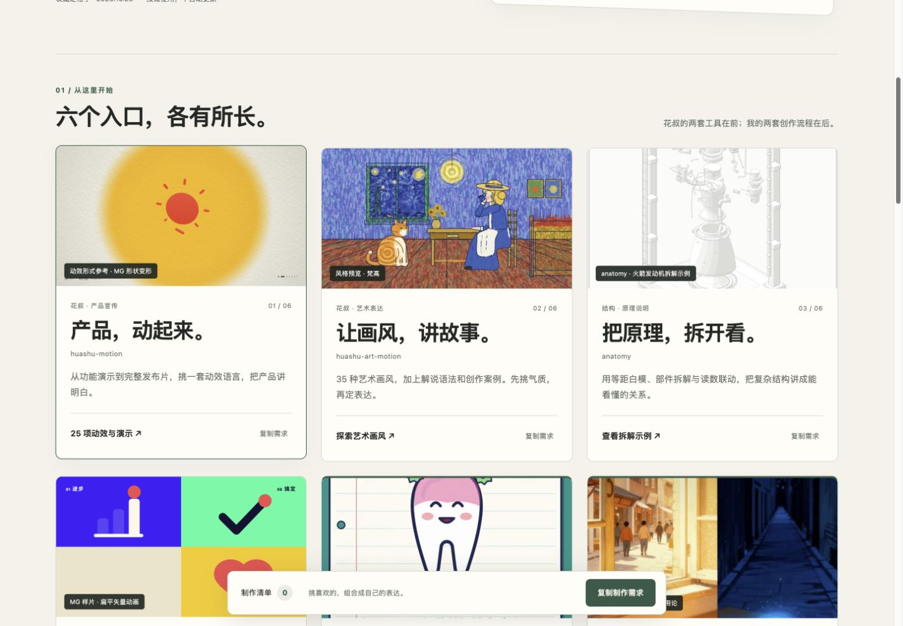

# 涛生 · 视频工作台

**先看见风格，再让想法动起来。**

[打开在线工作台](https://taosheng777.github.io/ai/video-workbench/) · [涛生 Skills 合集](https://github.com/Taosheng777/taosheng-skills) · [固定发行 v1.0.1](https://github.com/Taosheng777/video-workbench/releases/tag/v1.0.1)

这是我做视频时使用的一张工作台：先看示例，选择画风、动效与叙事方法，再把整理好的需求交给 AI。它是一份 **2026-10-25 固定收藏**，不自动安装、更新或追踪上游。



## 收录什么

| 入口 | 用途 | 内容 |
|---|---|---|
| 花叔 huashu-motion | 产品发布与动态讲解 | 20 种动效方向、5 支原作者演示入口 |
| 花叔 huashu-art-motion | 艺术画风与解说语法 | 35 种画风、9 种语法、9 个原作者案例 |
| anatomy | 结构与原理拆解 | 火箭发动机示例 |
| mg-styles-15 | MG 动态设计 | 15 支风格样片 |
| med-science-video | 涛生的医学科普流程 | 事实、脚本、视觉样张、制作与验收 |
| making-videos | 涛生的通用短片流程 | 立意、关键画面、镜头与成片检查 |

另保留 8 支个人作品介绍，精选 6 支提供约 10 秒预览。公开包约 40 MB，视频按需播放。

## 怎么用

最方便的是直接打开网页：默认先看我的6段10秒作品预览。切换“全部”后，个人视频在前，随后是其他视频、图片，文字介绍与外链靠后；可以搜索当前分类、收藏参考，再复制一条或一组制作需求。

要让 AI 帮你选型与按流程制作，可以安装本仓库。三个自有 Skill 在 `plugins/video-workbench/skills/`；第三方项目保留固定来源与许可，**没有随包安装**。

Claude Code：

```text
/plugin marketplace add Taosheng777/video-workbench
/plugin install video-workbench@video-workbench
```

Codex：

```sh
codex plugin marketplace add Taosheng777/video-workbench
```

然后在插件目录选择“涛生 · 视频工作台”。如果已安装涛生合集里的 `taosheng-video`，无需重复安装这个独立包，两处三个 Skill 内容相同。

不熟悉命令时，直接把 [固定版本 Skill 目录](https://github.com/Taosheng777/video-workbench/tree/v1.0.1/plugins/video-workbench/skills) 发给 AI，请它安装所需技能。安装行为仍由你决定，浏览看板不触发安装。

## 离线使用

下载 v1.0.1 Release ZIP，解压后打开 `plugins/video-workbench/skills/video-workbench/assets/board/index.html`。不需要 Node.js，也不需要账户。包内 64 个短视频预览离线可看，原作者外部演示需联网。

浏览器工具仅支持 HTTP 时，可以运行：

```sh
python3 plugins/video-workbench/skills/video-workbench/scripts/serve.py
```

终端会显示本机临时地址；仅监听回环地址，Ctrl-C 停止。收藏只保存在当前浏览器；离线文件与在线网页的收藏不会自动互通。

## 来源与许可

自有看板代码、文字与两套公开工作流按 [MIT](LICENSE) 开放。所有第三方出处、固定提交与媒体范围见 [来源页](plugins/video-workbench/skills/video-workbench/assets/board/sources.html) 和 [许可证目录](plugins/video-workbench/skills/video-workbench/assets/board/licenses/)。

人物形象、商标、原作者案例及个人作品不因本项目而统一获得 MIT 再许可。受单独授权限制的示范片仅提供原作者入口。医学作品短节选用于展示表达形式，不替代完整科普语境或具体就医判断。

快照没有后台任务、账号配置、自动备份或自动更新机制。网页、独立发行与合集使用同一份冻结内容；以后如整理新版，将另标版本与日期。
